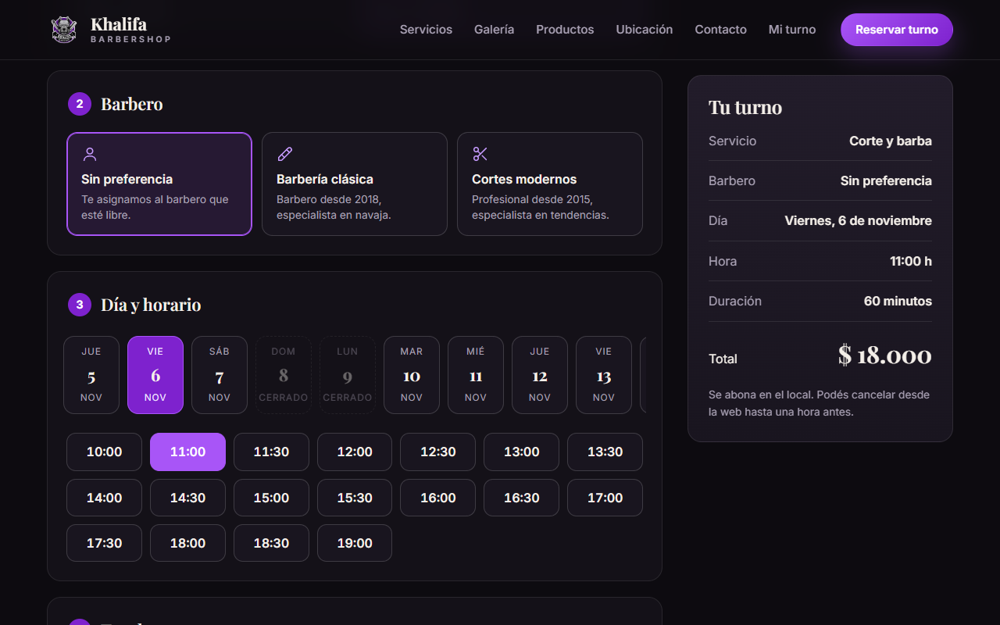
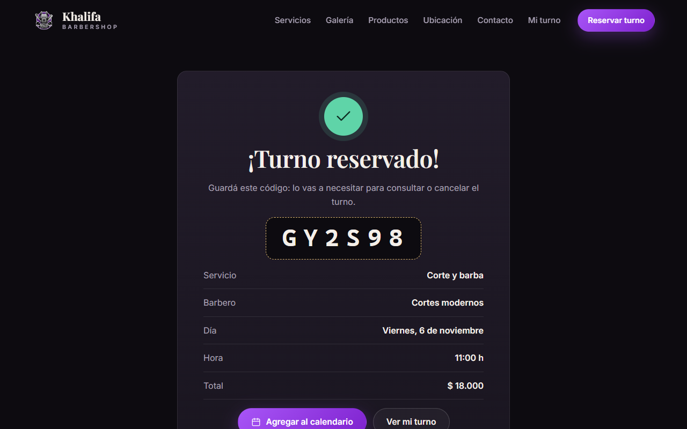
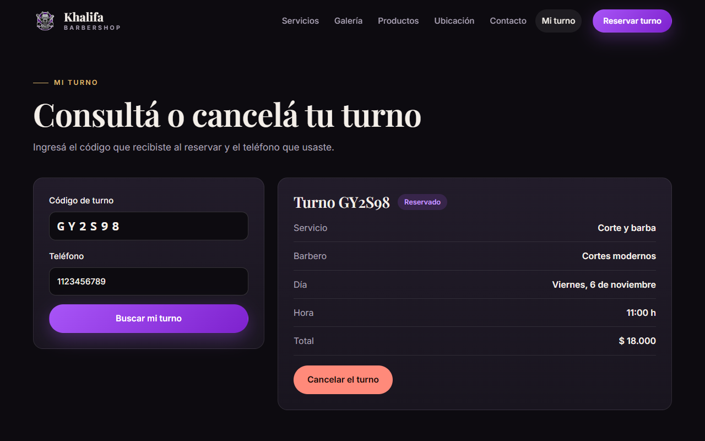
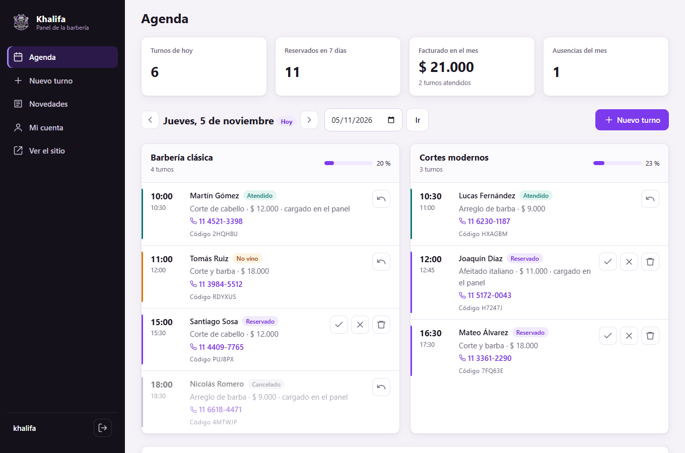
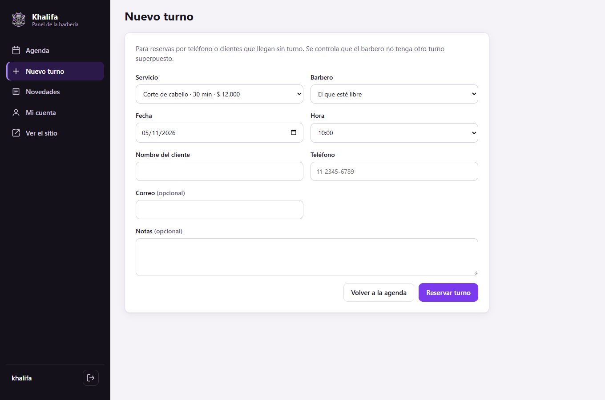
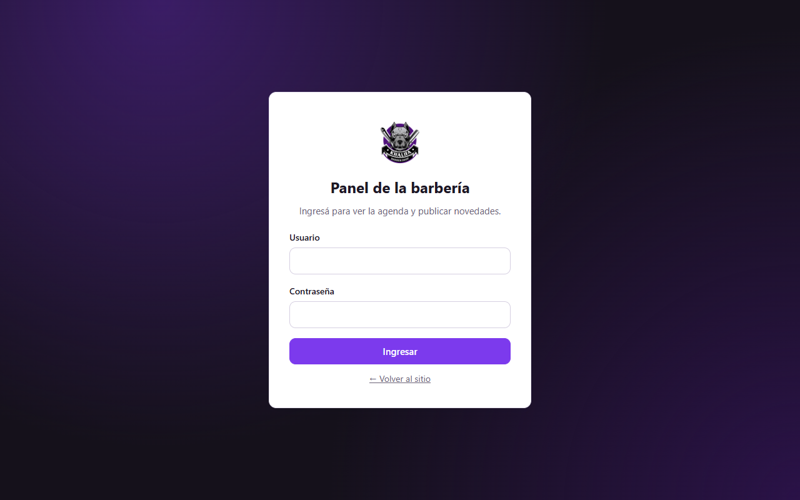
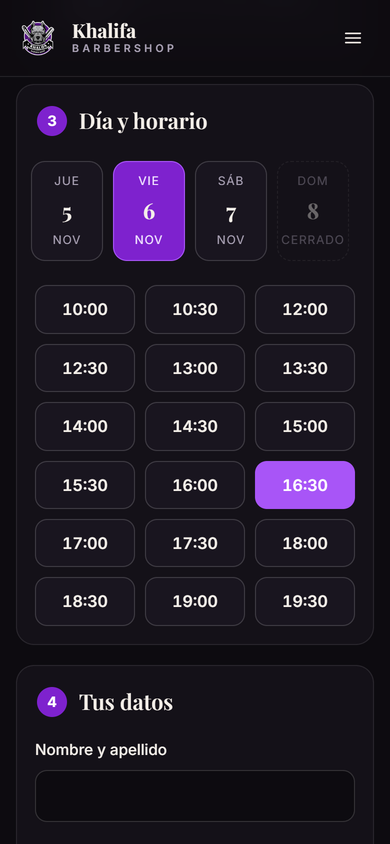
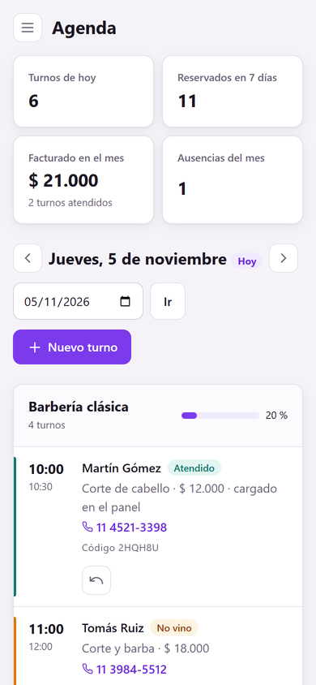
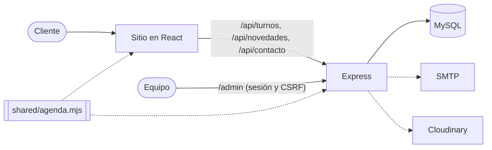

<div align="center">


# Khalifa Barbershop

**Sitio full stack para una barbería clásica**, con reserva de turnos online y panel de administración.


[](https://github.com/FedericoViceconte/khalifa-barbershop/actions/workflows/ci.yml)
[](https://github.com/FedericoViceconte/khalifa-barbershop/actions/workflows/pages.yml)

### [▶ Ver la demo en vivo](https://federicoviceconte.github.io/khalifa-barbershop/)


</div>

## Índice

- [Sobre el proyecto](#sobre-el-proyecto)
- [Demo en vivo](#demo-en-vivo)
- [Capturas](#capturas)
- [Funciones](#funciones)
- [Cómo funciona la agenda](#cómo-funciona-la-agenda)
- [Stack](#stack)
- [Arquitectura](#arquitectura)
- [Seguridad](#seguridad)
- [Ejecutar con Docker](#ejecutar-con-docker)
- [Ejecutar sin Docker](#ejecutar-sin-docker)
- [Variables de entorno](#variables-de-entorno)
- [Pruebas](#pruebas)
- [Estructura del proyecto](#estructura-del-proyecto)
- [Licencia](#licencia)

## Sobre el proyecto

Proyecto académico full stack iniciado en 2022 y renovado en 2026. El sitio presenta los servicios, el equipo y
los productos de una barbería de Ciudad Evita, y permite **reservar un turno en un minuto**: el cliente elige
servicio, barbero, día y horario, recibe un código y con ese código puede consultar o cancelar la reserva.

El equipo trabaja desde un **panel de administración** con la agenda del día por barbero, indicadores del mes,
carga de turnos telefónicos y publicación de novedades.

El frontend es una aplicación de React. El backend en Express sirve la API, el panel y la versión compilada del
sitio. Las reglas de la agenda (horarios, duraciones y superposiciones) están en un único módulo que comparten
los dos lados, así que el sitio y el servidor siempre calculan los mismos horarios.

## Demo en vivo

**[https://federicoviceconte.github.io/khalifa-barbershop/](https://federicoviceconte.github.io/khalifa-barbershop/)**

La demo publica solo el frontend en GitHub Pages, sin servidor. La agenda se simula en el navegador, con algunos
horarios ocupados, y las reservas se guardan en el almacenamiento local, de modo que también se pueden consultar y
cancelar desde **Mi turno**. Las novedades son de ejemplo y el formulario de contacto no envía correos, como
indica un aviso en pantalla. Se actualiza sola en cada cambio de `main` después de pasar las pruebas.

Para ver el panel de administración hay que correr el proyecto completo, por ejemplo con
[Docker](#ejecutar-con-docker).

## Capturas

**Reserva de turnos**

<table>
  <tr>
    <td></td>
    <td></td>
  </tr>
  <tr>
    <td align="center">Elección de barbero, día y horario, con el resumen siempre a la vista</td>
    <td align="center">Confirmación con código y archivo para el calendario</td>
  </tr>
  <tr>
    <td></td>
    <td></td>
  </tr>
  <tr>
    <td align="center"><b>Mi turno</b>: consulta y cancelación sin crear una cuenta</td>
    <td align="center"><b>Productos</b>: filtros, orden y precio final con descuento</td>
  </tr>
</table>

**Panel de administración**

<table>
  <tr>
    <td colspan="2"></td>
  </tr>
  <tr>
    <td colspan="2" align="center"><b>Agenda</b>: indicadores del mes, ocupación por barbero y acciones para marcar cada turno</td>
  </tr>
  <tr>
    <td></td>
    <td></td>
  </tr>
  <tr>
    <td align="center">Carga de turnos telefónicos o sin reserva</td>
    <td align="center">Acceso con límite de intentos</td>
  </tr>
</table>

**En el celular**

<p align="center">
  
  &nbsp;
  
  &nbsp;
  
</p>

## Funciones

**Sitio público**

- Portada, historia de la barbería, servicios con precio y duración, staff y **novedades cargadas desde la API**.
- **Reserva de turnos** en cuatro pasos: servicio, barbero (o sin preferencia), día y horario, y datos de contacto.
  Solo se ofrecen los horarios realmente libres para la duración del servicio elegido.
- Confirmación con un **código de seis caracteres** y un archivo `.ics` para agregar el turno al calendario.
- **Mi turno**: consulta y cancelación con el código y el teléfono, sin crear una cuenta.
- Catálogo de productos con filtros por categoría, orden por precio o descuento y precio final calculado.
- Galería con visor de imágenes, mapa y horarios, formulario de contacto por SMTP y página 404.
- Diseño adaptable, navegación con teclado, foco visible, enlace para saltar al contenido y animaciones reducidas
  si el sistema lo pide. Tipografías servidas desde el propio sitio, sin pedidos a terceros.

**Panel de administración** (`/admin`)

- **Agenda** por día y por barbero, con navegación entre fechas y porcentaje de ocupación.
- Indicadores: turnos de hoy, reservados en los próximos siete días, facturado y ausencias del mes.
- Acciones por turno: atendido, no vino, cancelar y volver a reservar (si el horario sigue libre).
- **Carga de turnos** telefónicos o de clientes sin reserva, con el mismo control de superposiciones.
- Alta, edición y baja de novedades, con imagen opcional en Cloudinary.
- Cambio de contraseña y mensajes de confirmación después de cada acción.

## Cómo funciona la agenda

Las reglas viven en [`shared/agenda.mjs`](shared/agenda.mjs), que importan tanto React como Express.

| Regla | Valor |
| --- | --- |
| Días y horario | Martes a sábado, de 10 a 20 h (hora de Buenos Aires) |
| Grilla | Un turno puede empezar cada 30 minutos |
| Servicios | Corte (30 min), barba (30 min), afeitado italiano (45 min), corte y barba (60 min) |
| Anticipación | Al menos 60 minutos para reservar o cancelar desde la web |
| Plazo | Hasta 21 días hacia adelante (90 desde el panel) |
| Sin preferencia de barbero | Se asigna el que esté libre y tenga menos turnos ese día |

Un horario está libre si el servicio entra completo antes del cierre y no se superpone con otro turno activo del
mismo barbero. Para que dos personas no reserven el mismo horario a la vez, el servidor toma un **bloqueo con
nombre por día** (`GET_LOCK` de MySQL) mientras verifica e inserta. Las pruebas de integración lanzan seis
reservas simultáneas del mismo horario y comprueban que solo una se confirma.

Los precios de los servicios son de ejemplo y se editan en el mismo archivo. Cada turno guarda el precio y la
duración del momento en que se reservó.

## Stack

| Capa | Tecnologías |
| --- | --- |
| Frontend | React 19, React Router 7, Axios, Vite 8, Inter y Playfair Display autoalojadas |
| Backend | Node.js 24, Express 5, Handlebars (panel), express-session |
| Seguridad | helmet (CSP y cabeceras), express-rate-limit, scrypt, tokens CSRF |
| Base de datos | MySQL 8.4 o MariaDB 11 (mysql2 con consultas parametrizadas) |
| Servicios | Nodemailer (SMTP) y Cloudinary (imágenes), ambos opcionales |
| Infraestructura | Docker y Docker Compose, GitHub Actions y GitHub Pages |
| Pruebas | Vitest y Testing Library (frontend), `node:test` contra MySQL real (backend) |

## Arquitectura



En desarrollo, Vite sirve el sitio en el puerto 3001 y reenvía `/api` y `/admin` al backend en el 3000. En
producción, Express sirve también el sitio compilado desde `frontend/build`. Al arrancar, el servidor crea las
tablas que falten y aplica los cambios de esquema pendientes, así que no hace falta importar SQL a mano.

| Método | Ruta | Descripción |
| --- | --- | --- |
| GET | `/api/salud` | Estado del servidor y de la base (lo usa Docker) |
| GET | `/api/novedades` | Últimas novedades |
| GET | `/api/turnos/disponibilidad?fecha&servicio&barbero` | Horarios libres de un día |
| POST | `/api/turnos` | Reserva un turno y devuelve su código |
| POST | `/api/turnos/consulta` | Consulta un turno con código y teléfono |
| POST | `/api/turnos/cancelar` | Cancela un turno con código y teléfono |
| POST | `/api/contacto` | Envía el mensaje del formulario |
| GET | `/admin/agenda?fecha` | Agenda del día (requiere sesión) |
| POST | `/admin/turnos/nuevo`, `/admin/turnos/:id/estado` | Carga de turnos y cambio de estado |
| GET / POST | `/admin/novedades/...`, `/admin/cuenta` | Novedades y cambio de contraseña |

## Seguridad

- **Contraseñas con scrypt** y sal aleatoria, comparadas en tiempo constante. Mínimo de 12 caracteres y cambio
  de contraseña desde el panel.
- **Límite de intentos**: 5 inicios de sesión fallidos cada 15 minutos por IP, y límites para reservas,
  consultas de turnos y el formulario de contacto.
- **Cabeceras de seguridad con helmet**: política de contenido (CSP) sin scripts ni estilos en línea, bloqueo
  de iframes de terceros sobre el sitio y HSTS cuando se sirve por HTTPS.
- **Protección CSRF** con un token por sesión en todos los formularios del panel.
- **Sesiones** guardadas en MySQL, regeneradas al iniciar sesión, con cookies `httpOnly` y `sameSite`.
- **Turnos privados**: consultar o cancelar exige el código y el teléfono, y la API nunca devuelve el teléfono.
- **Validación** de todos los datos en el servidor y **consultas parametrizadas** en todas las operaciones.
- **Subidas** limitadas a una imagen PNG, JPG o WebP de hasta 4 MB.
- La imagen de Docker corre con un usuario sin privilegios y el servidor exige un `SESSION_SECRET` de al menos
  32 caracteres para arrancar.

## Ejecutar con Docker

Requisito: **Docker** con Compose.

1. Copiá el archivo de variables y completá las claves:

   ```sh
   cp .env.example .env
   ```

   `MYSQL_PASSWORD`, `SESSION_SECRET` y `ADMIN_PASSWORD` son obligatorias. Para generar valores seguros:

   ```sh
   node -p "require('node:crypto').randomBytes(32).toString('hex')"
   ```

2. Levantá el sitio y la base:

   ```sh
   docker compose up -d --build
   ```

3. Abrí <http://localhost:3000>. El panel está en <http://localhost:3000/admin> con el usuario `ADMIN_USER` y la
   contraseña `ADMIN_PASSWORD`; ese primer administrador se crea solo la primera vez.

Para cargar novedades y turnos de ejemplo:

```sh
docker compose exec app npm --prefix backend run demo
```

Los datos quedan en el volumen `datos`. `docker compose down` detiene todo sin borrarlos; `docker compose down -v`
borra también la base.

## Ejecutar sin Docker

Requisitos: **Node.js 22.12 o posterior** (se recomienda 24) y **MySQL 8** o **MariaDB 10.6** o posterior.

1. Creá una base vacía, por ejemplo `khalifa_barbershop`, y un usuario con permisos sobre ella.
2. Copiá `backend/.env.example` a `backend/.env` y completá la conexión, `SESSION_SECRET` y el primer
   administrador (`ADMIN_USER` y `ADMIN_PASSWORD`).
3. Instalá las dependencias, compilá el sitio y arrancá el servidor:

   ```sh
   npm --prefix frontend ci
   npm --prefix frontend run build
   npm --prefix backend ci
   npm --prefix backend start
   ```

4. Abrí <http://localhost:3000>. Las tablas se crean al arrancar. Para datos de ejemplo:
   `npm --prefix backend run demo`.

Otros administradores se agregan con `ADMIN_PASSWORD=... npm --prefix backend run create-admin -- usuario`.

**Desarrollo con recarga en vivo:** con el backend en el puerto 3000, ejecutá `npm --prefix frontend start` y abrí
<http://localhost:3001>.

**Demo sin servidor en local:**

```sh
cd frontend
DEMO_BASE=/khalifa-barbershop/ VITE_DEMO=true npx vite build --outDir ../.demo-build
```

## Variables de entorno

| Variable | Uso |
| --- | --- |
| `HOST`, `PORT` | Dirección y puerto del servidor (por defecto `127.0.0.1:3000`) |
| `MYSQL_HOST`, `MYSQL_PORT`, `MYSQL_DB_NAME`, `MYSQL_USER`, `MYSQL_PASSWORD` | Conexión a MySQL o MariaDB |
| `SESSION_SECRET` | Secreto de las sesiones, de al menos 32 caracteres |
| `SESSION_STORE` | `mysql` guarda las sesiones en la base; `memoria` las pierde al reiniciar |
| `COOKIE_SECURE` | `true` si el sitio se sirve por HTTPS (cookies seguras y HSTS) |
| `TRUST_PROXY` | Cantidad de proxies inversos delante del servidor, para conocer la IP real |
| `ADMIN_USER`, `ADMIN_PASSWORD` | Primer administrador, creado al arrancar si no hay ninguno |
| `SMTP_HOST`, `SMTP_PORT`, `SMTP_USER`, `SMTP_PASS`, `CONTACT_EMAIL` | Envío real del formulario de contacto |
| `CLOUDINARY_URL` | Imágenes de las novedades |

Con Docker se usa el `.env` de la raíz (ver [`.env.example`](.env.example)), que además define `PUERTO`.

## Pruebas

```sh
npm --prefix frontend test   # 10 pruebas: portada, menú, productos, reserva, conflicto de horario, Mi turno,
                             # contacto, demo sin servidor, 404 y archivo de calendario
npm --prefix backend test    # 26 pruebas: reglas de la agenda, API, cabeceras, CSRF e integración con MySQL
```

Las 11 pruebas de integración del backend corren contra una base real y solo se ejecutan si se indica una base de
pruebas, que se vacía al empezar:

```sh
MYSQL_TEST_DB=khalifa_pruebas MYSQL_USER=... MYSQL_PASSWORD=... npm --prefix backend test
```

Cubren reservas, reparto entre barberos, superposiciones, pedidos simultáneos, consulta y cancelación, la agenda
del panel, la carga de turnos, las novedades, el cambio de contraseña, las sesiones en MySQL y el bloqueo después
de cinco intentos de inicio de sesión.

GitHub Actions corre en cada cambio el frontend, el backend con un servicio de **MySQL 8.4** y un tercer trabajo
que **construye la imagen y levanta todo con Docker Compose** para comprobar que el sitio, la API y el panel
responden.

## Estructura del proyecto

```text
khalifa-barbershop/
├── shared/
│   └── agenda.mjs           # reglas de la agenda, compartidas por el sitio y el servidor
├── frontend/
│   ├── public/img/          # logo, ícono y fotos de productos
│   └── src/
│       ├── components/      # encabezado, pie, íconos, servicios y novedades
│       ├── pages/           # Inicio, Servicios, Reservar, Mi turno, Galería, Productos, Ubicación, Contacto y 404
│       ├── api.js           # llamadas a la API y simulación de la demo
│       └── App.test.jsx
├── backend/
│   ├── bin/                 # arranque, alta de administradores y datos de ejemplo
│   ├── lib/                 # límites de pedidos, validaciones y ayudantes de las vistas
│   ├── models/              # conexión, esquema, turnos, novedades, usuarios y sesiones
│   ├── routes/              # API pública y panel de administración
│   ├── views/               # plantillas Handlebars del panel
│   ├── public/panel/        # estilos y JavaScript del panel
│   ├── sql/schema.sql       # tablas, creadas al arrancar
│   └── test/
├── Dockerfile
├── compose.yaml
└── docs/img/                # capturas del README
```

## Licencia

© 2026 Federico Viceconte. Todos los derechos reservados: ver [COPYRIGHT.txt](COPYRIGHT.txt). Las bibliotecas,
fuentes e íconos de terceros conservan sus licencias, detalladas en [LICENCIAS.txt](LICENCIAS.txt).
