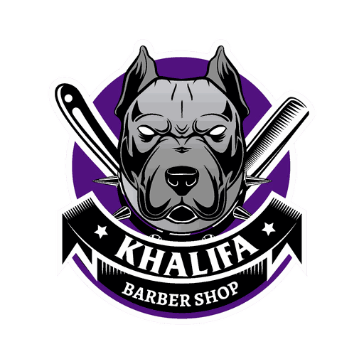
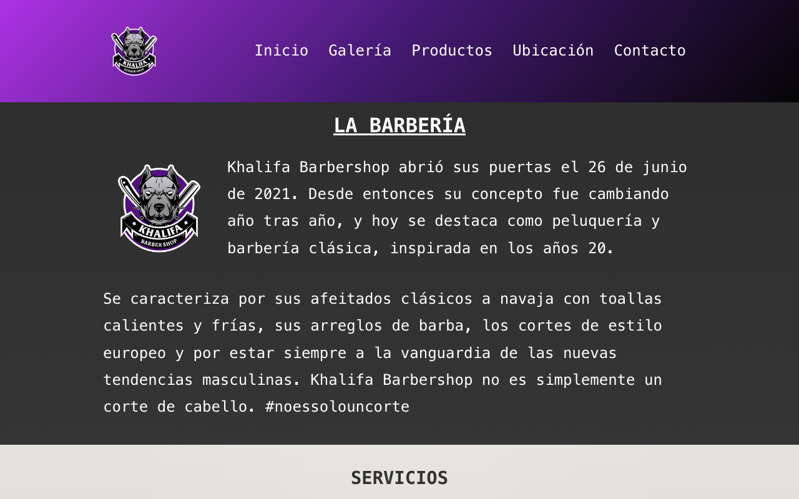
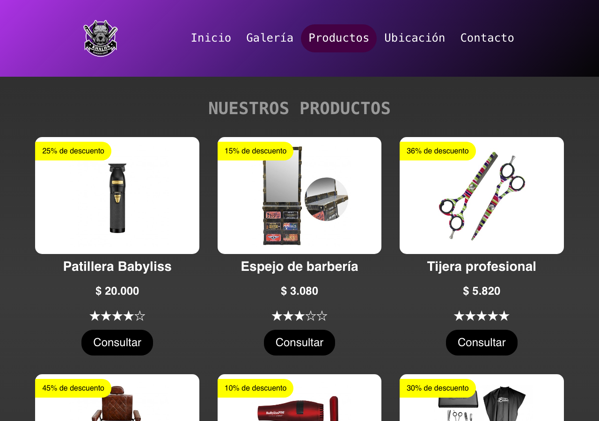
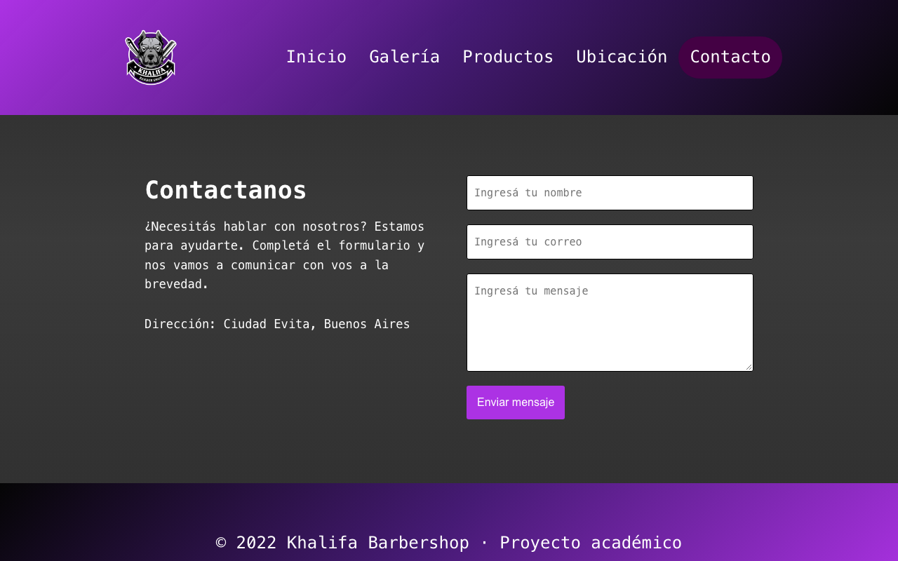
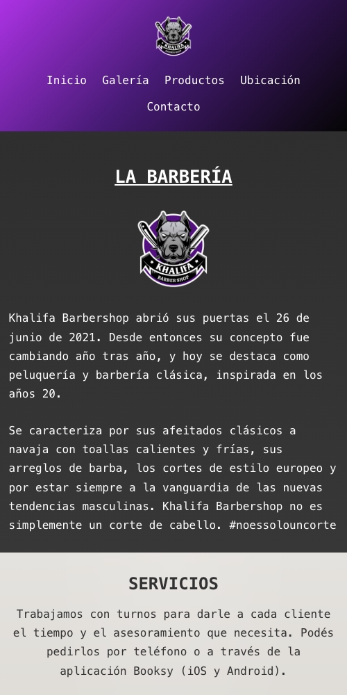
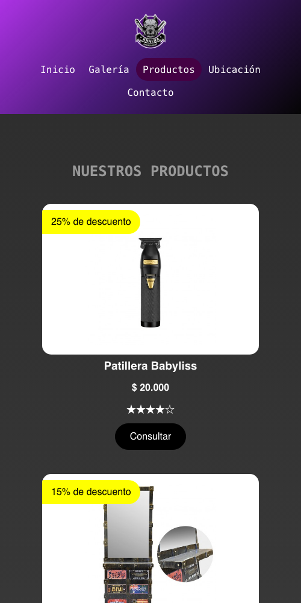

<div align="center">



# Khalifa Barbershop

**Sitio web full stack para una barbería clásica**, con panel de administración de novedades.




</div>

## Índice

- [Sobre el proyecto](#sobre-el-proyecto)
- [Capturas](#capturas)
- [Funciones](#funciones)
- [Stack](#stack)
- [Arquitectura](#arquitectura)
- [Seguridad](#seguridad)
- [Ejecutar en local](#ejecutar-en-local)
- [Variables de entorno](#variables-de-entorno)
- [Pruebas](#pruebas)
- [Estructura del proyecto](#estructura-del-proyecto)
- [Licencia](#licencia)

## Sobre el proyecto

Proyecto académico full stack iniciado en 2022. El sitio presenta los servicios, el equipo y
los productos de una barbería, muestra las últimas novedades y ofrece un formulario de contacto.
Las novedades se cargan desde un **panel de administración** propio, con inicio de sesión y
subida de imágenes.

El frontend es una aplicación de una sola página en React, y el backend en Express sirve la API,
el panel y la versión compilada del sitio.

## Capturas

<table>
  <tr>
    <td></td>
    <td></td>
  </tr>
  <tr>
    <td align="center"><b>Productos</b> · catálogo con precios en pesos y descuentos</td>
    <td align="center"><b>Contacto</b> · formulario validado en cliente y servidor</td>
  </tr>
</table>

<p align="center">
  
  &nbsp;&nbsp;
  
  <br><b>Diseño adaptable</b> · el sitio se reorganiza en tablet y celular
</p>

## Funciones

**Sitio público**

- Inicio con la historia de la barbería, servicios, staff y **novedades cargadas desde la API**.
- Galería de imágenes hecha solo con CSS.
- Catálogo de productos generado a partir de datos, con precios formateados en pesos.
- Formulario de contacto que envía un correo por SMTP. Sin SMTP configurado responde en modo
  demostración.
- Mapa de ubicación, página 404 y menú que marca la sección actual.

**Panel de administración** (`/admin`)

- Inicio y cierre de sesión.
- Alta, edición y baja de novedades, con imagen opcional alojada en Cloudinary.
- Alta de administradores desde la terminal con `npm --prefix backend run create-admin`.

## Stack

| Capa | Tecnologías |
| --- | --- |
| Frontend | React 18, React Router, Axios, Vite |
| Backend | Node.js, Express 4, Handlebars (panel), express-session |
| Base de datos | MySQL (mysql2 con consultas parametrizadas) |
| Servicios | Nodemailer (SMTP), Cloudinary (imágenes) |
| Pruebas | Vitest y Testing Library (frontend), `node:test` (backend) |

## Arquitectura

```text
Navegador ──► React (Vite) ──► /api/novedades, /api/contacto ──┐
                                                               ├─► Express ──► MySQL
Administrador ──► /admin (Handlebars, sesión, CSRF) ───────────┘        └──► Cloudinary · SMTP
```

En desarrollo, Vite sirve el frontend en el puerto 3001 y reenvía `/api` al backend en el 3000.
En producción, Express sirve también el frontend compilado desde `frontend/build`.

| Método | Ruta | Descripción |
| --- | --- | --- |
| GET | `/api/novedades` | Novedades de la más reciente a la más antigua |
| POST | `/api/contacto` | Envía el mensaje del formulario |
| GET / POST | `/admin/login` | Inicio de sesión del panel |
| GET | `/admin/novedades` | Listado de novedades (requiere sesión) |
| POST | `/admin/novedades/agregar`, `/modificar`, `/eliminar/:id` | Alta, edición y baja |

## Seguridad

- **Contraseñas con scrypt** y sal aleatoria, comparadas en tiempo constante.
- **Protección CSRF** con un token por sesión en todos los formularios del panel.
- La sesión se **regenera al iniciar sesión**, con cookies `httpOnly` y `sameSite`.
- **Validación de datos** en el servidor: longitudes, formato de correo y tipos de imagen.
- **Límites de subida**: una imagen de hasta 4 MB, solo PNG, JPG o WebP.
- **Consultas parametrizadas** en todas las operaciones con MySQL.
- El servidor exige un `SESSION_SECRET` de al menos 32 caracteres para arrancar.

## Ejecutar en local

Requisitos: **Node.js 22.12 o posterior** y **MySQL**.

1. Creá una base vacía llamada `khalifa_barbershop` e importá el esquema. La novedad de muestra
   es opcional:

   ```sh
   mysql -u TU_USUARIO -p khalifa_barbershop < backend/sql/schema.sql
   mysql -u TU_USUARIO -p khalifa_barbershop < backend/sql/demo.sql
   ```

2. Copiá `backend/.env.example` a `backend/.env`, completá `MYSQL_USER` y `MYSQL_PASSWORD`, y
   generá un secreto de sesión:

   ```sh
   node -p "require('node:crypto').randomBytes(32).toString('hex')"
   ```

3. Instalá las dependencias, compilá el frontend y arrancá el servidor:

   ```sh
   npm --prefix frontend ci
   npm --prefix frontend run build
   npm --prefix backend ci
   npm --prefix backend start
   ```

4. Abrí <http://localhost:3000>. Para el panel, agregá temporalmente `ADMIN_PASSWORD` a
   `backend/.env` (al menos 12 caracteres), ejecutá
   `npm --prefix backend run create-admin -- admin`, quitá esa variable y entrá en
   <http://localhost:3000/admin/login>.

**Desarrollo con recarga en vivo:** con el backend en el puerto 3000, ejecutá
`npm --prefix frontend start` y abrí <http://localhost:3001>.

## Variables de entorno

| Variable | Uso |
| --- | --- |
| `HOST`, `PORT` | Dirección y puerto del servidor (por defecto `127.0.0.1:3000`) |
| `MYSQL_HOST`, `MYSQL_DB_NAME`, `MYSQL_USER`, `MYSQL_PASSWORD` | Conexión a MySQL |
| `SESSION_SECRET` | Secreto de las sesiones, de al menos 32 caracteres |
| `COOKIE_SECURE` | `true` si el sitio se sirve por HTTPS |
| `SMTP_HOST`, `SMTP_PORT`, `SMTP_USER`, `SMTP_PASS`, `CONTACT_EMAIL` | Envío real del formulario de contacto |
| `CLOUDINARY_URL` | Imágenes de las novedades |

La configuración documentada es para una demo local: el servidor escucha en la interfaz local y
las sesiones se guardan en memoria.

## Pruebas

```sh
npm --prefix frontend test   # 5 pruebas: rutas, menú, productos, contacto y página 404
npm --prefix backend test    # 5 pruebas: validación, modo demostración, protección del panel y CSRF
```

Las pruebas del backend no necesitan MySQL ni servicios externos.

## Estructura del proyecto

```text
khalifa-barbershop/
├── frontend/
│   ├── public/img/          # logo, íconos y fotos de productos
│   └── src/
│       ├── components/      # cabecera, menú, pie y novedades
│       ├── pages/           # Inicio, Galería, Productos, Ubicación, Contacto y 404
│       └── App.test.jsx
├── backend/
│   ├── bin/                 # arranque del servidor y alta de administradores
│   ├── models/              # conexión a MySQL, novedades y usuarios
│   ├── routes/              # API pública y panel de administración
│   ├── views/               # plantillas Handlebars del panel
│   ├── sql/                 # esquema y datos de muestra
│   └── test/
└── docs/img/                # capturas del README
```

## Licencia

© 2026 Federico Viceconte. Todos los derechos reservados: ver [COPYRIGHT.txt](COPYRIGHT.txt). Las bibliotecas, fuentes e íconos de terceros conservan sus licencias, detalladas en [LICENCIAS.txt](LICENCIAS.txt).
